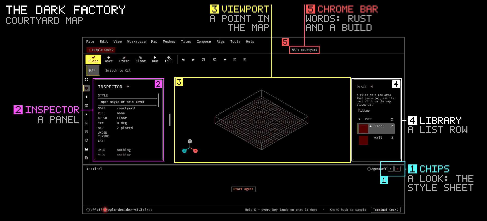
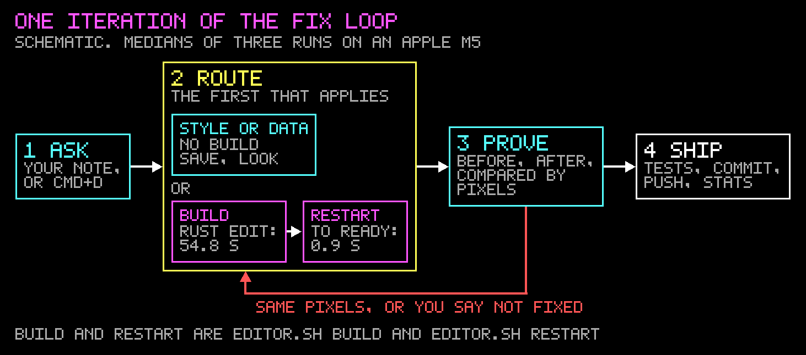
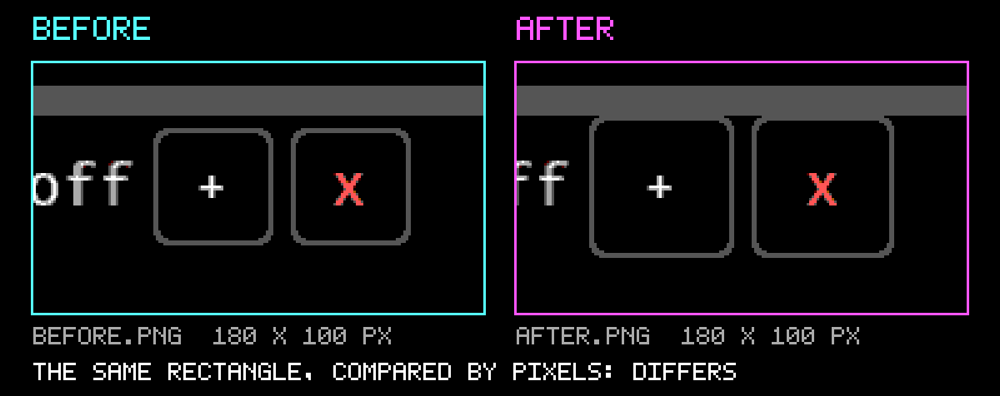

# Fix the Dark Factory in a minute or two

You say what is wrong with the Dark Factory, and the Night Shift (the agent you run with `omp`) changes it and shows you the result on screen: two drills took 72.6 s and 88.0 s from the report to the proof, the longer one including a 47.8 s build (`stats/iterations.tsv` in `workbench`, the loop's own repository, [named below](#where-the-numbers-come-from)).
This page walks a person and an agent through that loop, ask, look, edit, prove and ship, for whoever maintains the editor itself; to make a game with the editor, start with [the book](https://dark-incorporated.github.io/).

## Preview



*The Dark Factory on the sample game's `courtyard` map, in Dark Inc.'s house palette: five things a report can point at, numbered.*

A report can point at anything on screen: a panel, a button, a field, a piece, a cell or the empty viewport ([`docs/guide/agents.md`](https://github.com/dark-incorporated/bevy_dark_factory/blob/main/docs/guide/agents.md#reports-the-person-files) in `bevy_dark_factory`).
The five boxes are five examples, and their numbers come back in the steps.
Box 1 is the exact rectangle the loop cuts out in the worked example, and box 5 marks words in the chrome bar, the strip that says where you are; those words are written in Rust.

## What you need, once

The loop's commands and tools live in `dark-incorporated/workbench`, a private repository, so this page names it and does not link it.
Clone it as `~/dark-incorporated/.omp`, beside the editor's own clone, then build and start the editor:

```sh
mkdir -p ~/dark-incorporated && cd ~/dark-incorporated
git clone git@github.com:dark-incorporated/workbench.git .omp
git clone git@github.com:dark-incorporated/bevy_dark_factory.git
export CARGO_TARGET_DIR=$HOME/.cargo-target-shared/global                  # put this in your shell's rc file
git -C bevy_dark_factory config core.hooksPath tools/loop/hooks            # the push gate; without it a push runs nothing
git -C bevy_dark_factory lfs install --local --skip-repo                   # the gate's own hooks run LFS
echo 'games/sample/.dark_factory/' >> bevy_dark_factory/.git/info/exclude  # schema files the running editor writes there
.omp/tools/editor.sh build
.omp/tools/editor.sh start
omp                                                                        # always started in ~/dark-incorporated
```

Starting `omp` in `~/dark-incorporated` is what lets it find the workbench's commands (`.omp/commands/`) and its MCP (Model Context Protocol) server (`.omp/mcp.json`).
The first build is minutes, not a minute: `editor.sh build` printed `build 557.3s` for the first build at `main`, 232 commits after the previous one, and it left 3.7 GB free on a 461 GB disk.
Later builds are not like that: [the next section](#how-one-iteration-runs) gives their times.
While an iteration is open its edits sit uncommitted in `~/dark-incorporated/bevy_dark_factory`, so never `reset`, `checkout` or `clean` that clone; `/ship` commits them ([`WORKSPACE.md`](WORKSPACE.md) says who owns a clone).

## How one iteration runs



*One iteration of the fix loop, a schematic: the stages, the two ways through the route, and the way back from a rejected proof.*

An iteration is one `/fix`, from your report to the Night Shift's proof in the running editor.
A route is how the change reaches the screen, and the first route that applies wins.
A style edit shows on screen about a second after you save it, with no build ([`editor-dev.md`](https://github.com/dark-incorporated/bevy_dark_factory/blob/main/.omp/commands/editor-dev.md)), and a data edit needs no build either.
A Rust edit needs `editor.sh build`, median 54.8 s with incremental compilation on against 191.8 s with it off, and then `editor.sh restart`, median 0.9 s to ready (4.6 s the first time, while the freshly linked 1.3 GB binary loads).
Those are three runs each on an Apple M5 MacBook Air, from `docs/baseline.md` in the workbench.

## The steps

Each step has a **You** line and a **Night Shift** line, and none asks more than three minutes of you.
The worked example is the first drill, whose report was "make the chrome chip padding one step larger": the chips are box 1 above.
The commands' own files in the workbench, `commands/fix.md`, `commands/ship.md` and `commands/loop-stats.md`, are the full procedure; each Night Shift line here only names what it runs.

### 1. Say what is wrong

- **You:** write one sentence in `omp`, or press `Cmd+D` in the editor, point at the thing (a chip is 1, a panel 2, the map 3, a library row 4, words 5), type a note and run `/fix capture`; `Cmd+Shift+D` reports on a project, which this loop does not read.
- **Night Shift:** begins the iteration, tests and commits the previous fix if one is waiting, reads the report (for a capture, the newest entry of `blueprint_feedback_list`) and searches the open issues, whose match goes into the commit as `Fixes #N`.

```text
/fix make the chrome chip padding one step larger
```

### 2. Look

- **You:** nothing yet.
- **Night Shift:** takes a still with `blueprint_capture_still`, then cuts the region round the thing (a capture's pick, or the node it found in the still), padded by 40 px on every side and clamped to the window, with `blueprint_snip`; that picture is `before.png`.

```text
blueprint_snip {"label": "fix/<id>", "rect": [2380, 1000, 2560, 1100]}
```

That `rect` is the example's: 180 × 100 window pixels at the terminal bar's right end, which is box 1.
For a `Cmd+D` capture, the capture's own picture is the before, cropped to the same rectangle.

### 3. Fix it by the cheapest route

- **You:** nothing.
- **Night Shift:** takes the first route in this table that applies.

| Route | When it applies | What it costs |
|---|---|---|
| `style` | the problem is a look, like the chips (1), and `blueprint_ui_style_inspect` at its pixel resolves it to a rule | save `style/editor.yaml`; no build |
| `data` | the problem is in settings, project YAML or Rhai | save; no build |
| `family` | the cause is in a family crate, one of Dark Inc.'s other crates | edit that crate's clone, build with `DF_PATCH_LOCAL=<crate>`, restart |
| `relaunch` | everything else in Rust, like the words in the chrome bar (5) | `editor.sh build`, then `editor.sh restart` |
| hotpatch | closed | `docs/hotpatch-spike.md` in the workbench ends in NO-GO: 0 of 4 edits to the editor's library reached the screen, because the library shares its package with the binary, so a patch never contains it |

In the example, the chips' padding is one rule, `.chrome-chip` in `crates/bevy_dark_factory/src/style/editor.yaml`, and one edit to it was the whole fix.
A Rust edit runs these two commands, one at a time, because the timing is read from the session log:

```sh
.omp/tools/editor.sh build
.omp/tools/editor.sh restart
```

### 4. Prove it



*The terminal bar's chips before and after the style fix, the rectangle boxed as 1 above, in Dark Inc.'s house palette.*

- **You:** nothing yet.
- **Night Shift:** cuts the same rectangle again as `after.png`, compares the two by pixels, and posts both with one sentence on what you now see, the route and the files it changed.

`same` means the fix did not show, and the Night Shift goes back to step 3.
`$IT` is the iteration's folder, `~/.local/state/dark-incorporated/iterations/<id>`:

```sh
python3 -c "import sys; from PIL import Image, ImageChops; a, b = (Image.open(p).convert('RGB') for p in sys.argv[1:]); print('same' if a.size == b.size and ImageChops.difference(a, b).getbbox() is None else 'differs')" $IT/before.png $IT/after.png
```

### 5. Check it yourself

- **You:** look at the two pictures, or at the editor. If it is right, do nothing. If it is not, reply `not fixed` in plain words, not with a new `/fix`.
- **Night Shift:** takes the same iteration back to step 3 and marks it shown again.

**This is the human half of the loop, and it is designed, not measured.**
Both drills were run end to end by an agent, and no person replied to either: `rejections` is 0 and `rework_s` is 0.0 in both rows.
`iterations.py` already times a plain reply as `rework_s` and counts `rejections`, so the first real iteration will measure it.

### 6. Ship the batch

- **You:** run `/ship` when you want the shown fixes kept.
- **Night Shift:** tests and commits each shown fix with its changelog line, pushes any family crate and bumps the editor's pinned revision of it, pushes `bevy_dark_factory` through its pre-push gate, which builds and tests the whole workspace and takes tens of minutes on this laptop, and commits the statistics.

```text
/ship
```

### 7. Watch the loop itself

- **You:** run `/loop-stats`.
- **Night Shift:** runs `python3 .omp/tools/iterations.py record`, then `plot`, then `report --last 20`: the first two write `stats/iterations.tsv`, one row per iteration, and `stats/iterations.svg`, its plot, and the third prints the last 20 rows as tables.

```text
/loop-stats
```

The two drills are the only rows so far:

| Drill | Report | Route | To proof | The biggest part |
|---|---|---|---|---|
| `drill-chip-padding` | one sentence in chat | `style` | 72.6 s | the model, 57.1 s |
| `drill-readout-quotes` | a `Cmd+D` capture | `relaunch` | 88.0 s | compiling, 47.8 s, with 4.5 s to restart and 33.9 s of the model |

A row's activities overlap, because parallel tool calls overlap, so they can add up to more than its time to proof.

## If it goes wrong

| What you see | Why | What to do |
|---|---|---|
| `already running pid <pid>` | `editor.sh start` found the editor it started earlier | `editor.sh restart`, or `editor.sh stop` first |
| `editor.sh: <N> GB free; build refused` | under 8 GB was free after the script deleted `debug/incremental`, then the dependency files older than 14 days | free disk space; the first build at `main` left 3.7 GB free on a 461 GB disk |
| `editor.sh: port 15702 is held by <name> pid <pid>; quit it first` | something else, usually another editor, serves BRP (the Bevy Remote Protocol) on the port the MCP server dials | quit it; `lsof -nP -iTCP:15702 -sTCP:LISTEN` names it |
| `binary: stale binary (built <N>s after this editor started)` | `editor.sh status` found a build newer than the running editor | `editor.sh restart`; a build alone does not change the editor on screen |
| `no iteration <id> under <dir>` | a marker was given an id that `begin` never made | copy the id from the `iteration <id> begins` line |
| `iterations: slug '<slug>' is not kebab-case (a-z, 0-9, single hyphens)` | `begin --slug` refuses capitals, underscores and double hyphens | write it as `drill-chip-padding` |
| `sccache: incremental compilation is prohibited: Unset CARGO_INCREMENTAL to continue` | sccache 0.19, a compiler cache, refuses `CARGO_INCREMENTAL` | unset it: `editor.sh` turns incremental compilation on with `CARGO_PROFILE_DEV_INCREMENTAL=true`, which sccache accepts |
| `pre-push gate: REFUSED: <reason>` | the gate in `tools/loop/hooks/pre-push` refused the push | read the reason, fix it and push again; never `--no-verify` |
| `Warning: MCP server "<name>" failed to connect: HTTP 422: Unexpected message, expect initialize request; its tools are unavailable for this run.` | one of your own MCP servers, from your global configuration, is down | nothing: the loop's server is `bevy_blueprint`, and it is unaffected |

## Review

- The loop's cost is a build, 54.8 s at the median for a Rust edit, or nothing for a style or data edit, plus the Night Shift's own time: 57.1 s of the first drill's 72.6 s.
- Your part is the note and the verdict: say what is wrong, then say `not fixed` or say nothing.
- Every number here reproduces: `editor.sh build` and `editor.sh restart` give the build and the restart, and `iterations.py record` and `report` give the drills.

## Where the numbers come from

| Number | Where it is | How it was produced |
|---|---|---|
| 54.8 s and 191.8 s | `docs/baseline.md` rows B2 and B1 in the workbench: medians of three runs on an Apple M5 MacBook Air | `editor.sh build` prints `build <N>s`; one character of `chrome.rs` was edited before each run, with incremental compilation on for B2 and off for B1 |
| 0.9 s, and 4.6 s the first time | `docs/baseline.md` row B3 | `editor.sh restart`, from SIGINT to BRP answering |
| 557.3 s and 3.7 GB | the first build at `main` on 2026-11-23 | `editor.sh build` printed `build 557.3s`; `docs/baseline.md` records the 3.7 GB |
| about a second | [`editor-dev.md`](https://github.com/dark-incorporated/bevy_dark_factory/blob/main/.omp/commands/editor-dev.md) | stated there, and not timed by the drills |
| 72.6 s, 88.0 s, 57.1 s, 33.9 s, 47.8 s and 4.5 s | `stats/iterations.tsv`, the two `drill-` rows | `python3 .omp/tools/iterations.py record`, then `report --last 20` |
| 0 of 4 | `docs/hotpatch-spike.md`: one attempt with dx 0.7.10 and three with 0.8.0-alpha.3 | `dx serve --hot-patch` (dx is the Dioxus command line tool), then a poll of BRP `world.query` every 50 ms |
| tens of minutes | `commands/ship.md` | the pre-push gate; `tail -5 bevy_dark_factory/.git/gate.log` gives its step times |

## Why the figures look like this

The figures come from [`art/fix_loop_figure.py`](../art/fix_loop_figure.py), whose `--check` re-measures them, and they follow three findings:

- A picture with cues that guide attention to the relevant part is understood more deeply, so the numbered boxes are drawn on a real capture and not beside a drawing of it (van Gog 2021, [10.1017/9781108894333.022](https://doi.org/10.1017/9781108894333.022); the size of the effect was not read).
- Words belong beside the picture they explain, so each label sits in the margin nearest its box and a line joins them, with no legend to look up (Mayer 2020, [10.1017/9781316941355.012](https://doi.org/10.1017/9781316941355.012)).
- A diagram with arrows is read as a process and one without as a structure, so arrows appear in the flow figure only (Heiser & Tversky 2006, [10.1207/s15516709cog0000_70](https://doi.org/10.1207/s15516709cog0000_70)).

The page's own shape, a preview, numbered steps of at most three minutes each and a review of three bullets, is the one [`DOCUMENTATION.md`](../DOCUMENTATION.md) section 8 gives a walkthrough, and [If it goes wrong](#if-it-goes-wrong) names the real error text.
