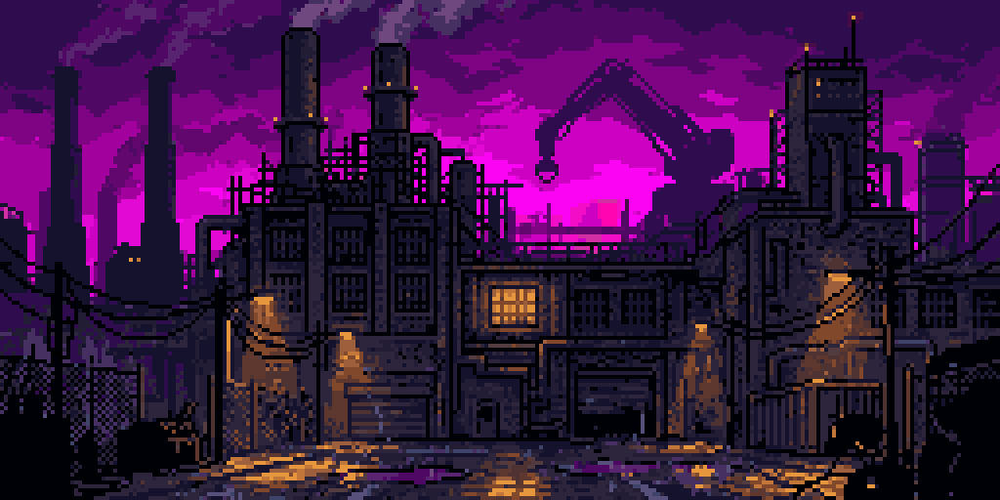

# Dark Inc.

**Lights out. The machines are working.**

Dark Inc. builds an agent-first game editor and the Bevy runtime crates around it, so you set direction and the Night Shift does the work, and it all looks like a gothic industrial machine-cathedral against a neon cyberpunk night city, drawn as 80s pixel art.

> ⚠️ **Vibe Coded.** Written by AI agents working from a human's direction, covered by tests rather than a line-by-line human review. Read the code before you rely on it for something you care about.

## The family

<!-- family:begin -->
|Part|Crate|What it does|Latest|Docs|
|---|---|---|---|---|
|**The editor**|[bevy_dark_factory](https://github.com/dark-incorporated/bevy_dark_factory)|A standalone world-building editor: author maps from an asset library, save what a game can load.|git only|[book](https://dark-incorporated.github.io/crates/bevy_dark_factory/)|
|**Interface**|[bevy_gooey](https://github.com/dark-incorporated/bevy_gooey)|Game and tool interfaces for Bevy 0.20: a skin, ready-made widgets and keyboard and gamepad navigation, built on Bevy's own headless widgets (the behaviour with no look of its own).||[docs.rs](https://docs.rs/bevy_gooey) · [book](https://dark-incorporated.github.io/crates/bevy_gooey/)|
|**World**|[bevy_elements](https://github.com/dark-incorporated/bevy_elements)|Living environments for Bevy 0.20: a sun and moon on real ephemerides, the bright-star sky, a seeded climate that schedules hourly weather, a GPU wind field, volumetric clouds, rain and snow, lightning and thunder, fog, heightfield terrain with erosion and flooding, ground cover, rocks, dust, paths and trails — all in compute shaders, for anyone building an open world that has to look alive without a weather artist.||[docs.rs](https://docs.rs/bevy_elements) · [book](https://dark-incorporated.github.io/crates/bevy_elements/)|
||[bevy_flora](https://github.com/dark-incorporated/bevy_flora)|**Parametric, stylized procedural trees for Bevy that grow over time**, for anyone building a forest without modelling one: pick one of 20 presets or tune every parameter, spawn a component, and watch a seedling grow into a mature tree. The same seed always gives the same tree.||[docs.rs](https://docs.rs/bevy_flora) · [book](https://dark-incorporated.github.io/crates/bevy_flora/)|
||[isomesh](https://github.com/dark-incorporated/isomesh)|Signed distance field in, triangles out: isosurface extraction for Rust voxel games and CAD tools, with a Bevy plugin.| |[docs.rs](https://docs.rs/bevy_isomesh) · [book](https://dark-incorporated.github.io/crates/isomesh/)|
||[bevy_lights](https://github.com/dark-incorporated/bevy_lights)|Practical lights for Bevy: the fires a scene's props actually carry — a budgeted pool of real lights over thousands of virtual ones, with shader flames and the flicker that makes them read.||[docs.rs](https://docs.rs/bevy_lights) · [book](https://dark-incorporated.github.io/crates/bevy_lights/)|
||[bevy_light_grid](https://github.com/dark-incorporated/bevy_light_grid)|An illuminance grid that creature AI can read: "how bright is it here, and which way is brighter", computed on the CPU per cell, for games where things flee or seek the light.|git only|[book](https://dark-incorporated.github.io/crates/bevy_light_grid/)|
|**Life**|[bevy_society](https://github.com/dark-incorporated/bevy_society)|Give your Bevy world a living society: villagers who remember, gossip, take sides, fall out and make up, and whose days you can script.||[docs.rs](https://docs.rs/bevy_society) · [book](https://dark-incorporated.github.io/crates/bevy_society/)|
||[bevy_stigmergy](https://github.com/dark-incorporated/bevy_stigmergy)|Fading marks on a grid that a crowd coordinates through, like ant trails: for game AI that should converge, scatter or rally without any agent planning a route.||[docs.rs](https://docs.rs/bevy_stigmergy) · [book](https://dark-incorporated.github.io/crates/bevy_stigmergy/)|
||[bevy_orca](https://github.com/dark-incorporated/bevy_orca)|Walkers that steer around each other without colliding: ORCA (optimal reciprocal collision avoidance) as a plain library on `bevy_math`'s `Vec2`, for crowds in games.||[docs.rs](https://docs.rs/bevy_orca) · [book](https://dark-incorporated.github.io/crates/bevy_orca/)|
||[bevy_speech_bubbles](https://github.com/dark-incorporated/bevy_speech_bubbles)|Speech balloons, barks, conversation graphs and a skinnable dialog box for Bevy games whose characters talk.||[docs.rs](https://docs.rs/bevy_speech_bubbles) · [book](https://dark-incorporated.github.io/crates/bevy_speech_bubbles/)|
|**Spectacle**|[bevy_carnage](https://github.com/dark-incorporated/bevy_carnage)|Wounds that peel to the bone, bleed, pool and dry, and bodies that break into chunks, for Bevy characters, deterministic to the bit.||[docs.rs](https://docs.rs/bevy_carnage) · [book](https://dark-incorporated.github.io/crates/bevy_carnage/)|
|**Agents and tooling**|[bevy_fairy](https://github.com/dark-incorporated/bevy_fairy)|Let a coding agent look inside a running Bevy game, drive it, and ask the person playing it for help — without touching your desktop.||[docs.rs](https://docs.rs/bevy_fairy) · [book](https://dark-incorporated.github.io/crates/bevy_fairy/)|
||[bevy_devshot](https://github.com/dark-incorporated/bevy_devshot)|A frame on demand: touch a sentinel file and the next frame writes a PNG, straight from the GPU.|git only|[book](https://dark-incorporated.github.io/crates/bevy_devshot/)|
|**Sound**|[bevy_siren](https://github.com/dark-incorporated/bevy_siren)|Sound for Bevy 0.20 that decides *what* plays and *how loud*: cues with variants, buses that duck, a voice budget that refuses politely, music that changes on the bar, and a log of what played and why.||[docs.rs](https://docs.rs/bevy_siren) · [book](https://dark-incorporated.github.io/crates/bevy_siren/)|
|**Presence (VR)**|[bevy_presence](https://github.com/dark-incorporated/bevy_presence)|Presence for Bevy: the crates a VR game needs to put a player in a room with a character who listens, answers, looks at them and moves its mouth.|git only|[book](https://dark-incorporated.github.io/crates/bevy_presence/)|
<!-- family:end -->

## Start here

- [The Dark Inc. book](https://dark-incorporated.github.io/): how the crates fit together, and how to use each one alone or in the Dark Factory.
- [What Dark Inc. is and where it is going](https://github.com/dark-incorporated/.github/blob/main/VISION.md): the goals, the projects, and the names (Dark Inc., Dark Factory, the Night Shift, blueprint).
- [How the crates fit together](https://github.com/dark-incorporated/.github/blob/main/docs/ARCHITECTURE.md): the layers, the dependency edges, and the engine-free crates.
- [How Dark Inc. writes code](https://github.com/dark-incorporated/.github/blob/main/docs/STYLE.md): naming, the machine plate, dependencies, layout, Rust, tests and shipping.
- [How every crate is documented](https://github.com/dark-incorporated/.github/blob/main/DOCUMENTATION.md): the document set, the README order, the checks and the review rubric.
- [Names, voice, the palette and the art](https://github.com/dark-incorporated/.github/blob/main/STYLE.md): the canonical names, the EGA palette, the motif and the art pipeline.
- [How a person and an agent fix the editor](https://github.com/dark-incorporated/.github/blob/main/docs/fix-loop.md): the fix loop, ask, look, edit, prove and ship, with its measured times and its error messages.
- [Contributing](https://github.com/dark-incorporated/.github/blob/main/CONTRIBUTING.md).

New machine? Set it up with [the workspace guide](https://github.com/dark-incorporated/.github/blob/main/docs/WORKSPACE.md).
